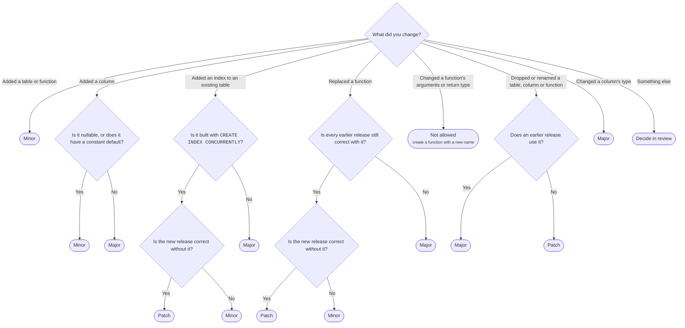

# Database schema

This guide says how to change the engine's database schema. Read the [database
schema] section of the README and the [automatic schema migration flowchart]
first.

The **target** is the schema version required by a runkit version:
`TargetVersion`, in [`internal/schema/version.go`].

## Changing the schema

1. Change the SQL in [`internal/schema/internal/current`]. Make each statement
   work even when its table, function or trigger already exists. For example,
   use `CREATE TABLE IF NOT EXISTS` and `CREATE OR REPLACE FUNCTION`.
2. If the change alters a table that already exists, including its columns,
   indexes, constraints or rows, or drops or renames anything, add a migration.
3. Choose a new schema version according to the rules below, and set
   `TargetVersion` to it.

To change the `runkit.schema_version` table, change [`bootstrap.sql`], not a
migration. Use statements that work on a table that already exists. For
example, use `ADD COLUMN IF NOT EXISTS`.

## Choosing the schema version

The chart uses three terms:

- **Earlier releases** are all the released runkit versions with the same major
  schema version as the new release, not only the latest one. An application
  can upgrade from any of them, and its engines keep running during the upgrade
  and after it.
- A runkit version is **correct** with a schema if its engines do everything it
  promises, with no errors. Running slower doesn't make it incorrect.
- A runkit version **uses** a table or column if its code reads from it or
  writes to it, and uses a function if its code calls it. To find out, search
  the code of each earlier release.

Find each change in the chart. Raise the highest number that any of the changes
reaches.



## Adding a migration

Add a directory to [`internal/schema/internal/migrations`] named after the new
target, such as `v2.1.0`. Add one file to it for each step, named with a
two-digit number, a hyphen, a short description, and `.tx.sql` or `.stmt.sql`,
such as `10-add-queues.tx.sql`. The steps run in the order of their numbers.

- Use a **`tx` step** for statements that must take effect together, or not at
  all. They run in one transaction.
- Use a **`stmt` step** for one statement that is slow, or that PostgreSQL won't
  run in a transaction. Make it safe to run twice. For example, use
  `IF NOT EXISTS`.

In a migration that raises only the minor or patch number:

- Make each statement of a `tx` step finish within `schemaLockTimeout` and
  `schemaStatementTimeout`, in [`engine.go`].
- Make each `stmt` step a statement that doesn't block reads or writes, such as
  `CREATE INDEX CONCURRENTLY`.

In a migration that raises the major number, a `stmt` step may also be a `DO`
block that commits in batches.

### Making the result match a new database

A migrated database must end up the same as a new one:

- When a migration fills a new table, create the table in the migration, with
  the same definition as in the current schema.
- When a migration adds a column, put the column last in its table in the
  current schema.
- When a step builds an index, give the index the same name in the current
  schema.
- When a migration renames a table, also rename the constraints and indexes that
  PostgreSQL named after the table.

The tests of the `schema` package check this, by comparing a migrated database
with a new one.

When a migration moves or changes rows, add a test that creates a database at
the schema version before the migration, inserts rows, upgrades the database,
and checks the rows.

## The engine's SQL

Always name columns explicitly in the engine's queries.

## Fixing a migration

Before a migration is released, edit it in place. Drop and recreate each
development database that has run it, even part of it.

After a migration is released, fix it in one of two ways, depending on what
went wrong:

- **A step fails to apply due to a bug.** Change only that step and the steps
  after it, and keep the schema version. Never change, insert or remove a step
  before it.
- **The migration completes with an incorrect result.** Leave the migration as
  it is, and fix the result with a later migration.

## Hotfixes

Don't change the schema in a release of a runkit version that isn't the latest
with its major schema version. Make the change in a new release of the latest
one instead.

## Releasing a schema change

- Start the section of the runkit version in [`CHANGELOG.md`] with a line that
  gives the target, before any other text: `Schema version: v2.0.0 (new)`. Write
  `(new)` if the runkit version is the first with that schema version, and
  `(existing)` otherwise.
- If the upgrade takes longer the more data the database holds, say so in the
  change's entry, and say what it does. For example, "the upgrade builds a new
  index over every event".

If the release raises the major number, also:

- Add this note after the schema version line and any summary of the release,
  before the first heading. Link `[major schema upgrades]` to the full GitHub
  URL of the README's [major schema upgrades] section.

  ```markdown
  > [!IMPORTANT]
  > This release includes breaking changes to the engine's SQL schema, so
  > upgrading a database from an earlier runkit version requires downtime.
  > Follow the steps in [major schema upgrades].
  ```

- Add a **[BC]** entry for the change, which names the engines that must be
  stopped.

<!-- references -->

[`bootstrap.sql`]: ../../internal/schema/internal/bootstrap/bootstrap.sql
[`CHANGELOG.md`]: ../../CHANGELOG.md
[`engine.go`]: ../../engine.go
[`internal/schema/internal/current`]: ../../internal/schema/internal/current/
[`internal/schema/internal/migrations`]: ../../internal/schema/internal/migrations/
[`internal/schema/version.go`]: ../../internal/schema/version.go
[automatic schema migration flowchart]: ../automatic-schema-migration.md
[bc]: https://github.com/dogmatiq/.github/blob/main/VERSIONING.md#changelogs
[database schema]: ../../README.md#database-schema
[major schema upgrades]: ../../README.md#major-schema-upgrades
