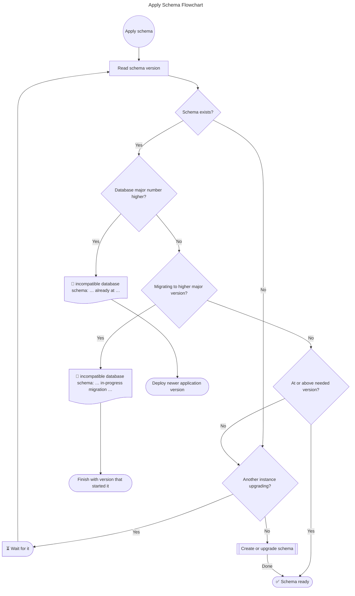
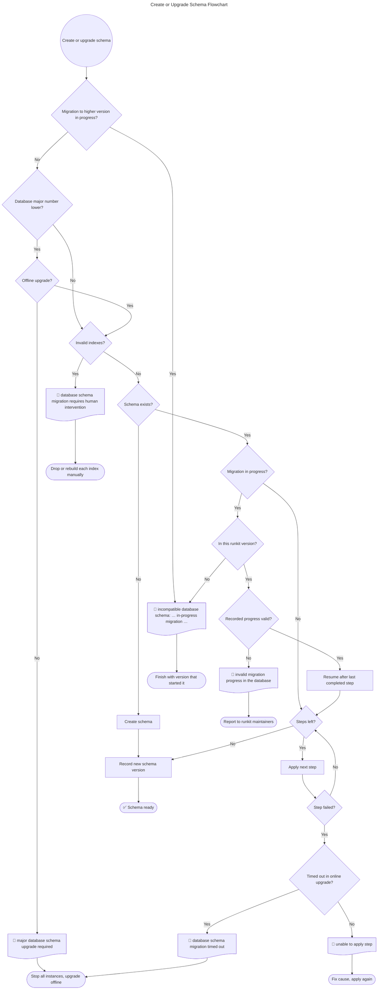

# Schema upgrades

These flowcharts show what happens to the database schema when an application
built with runkit applies it, and what to do at each outcome.

An application applies online upgrades automatically, by calling
`ApplySchemaOnline()` as it starts. Every instance does this, while other
instances keep running. An upgrade that raises the major number of the schema
version has to be applied offline, with every instance stopped. The
application's developer provides a separate way to run it, such as a deployment
step that calls `ApplySchemaOffline()`, as [Major schema upgrades] explains.

## Applying the schema

Each instance of the application compares the database's schema version with the
schema version that its runkit version needs. A node that starts with 🛑 holds
the start of an error message that the application reports.

## Creating or upgrading the schema

One instance at a time creates or upgrades the schema, and resumes where an
earlier attempt stopped. [Upgrading] says how to run an offline upgrade.

<!-- references -->

[major schema upgrades]: ../README.md#major-schema-upgrades
[upgrading]: ../README.md#upgrading
